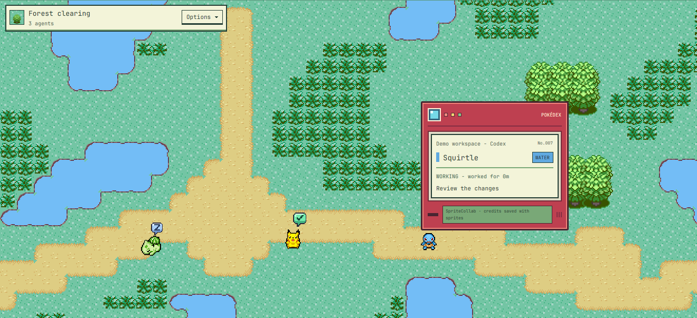
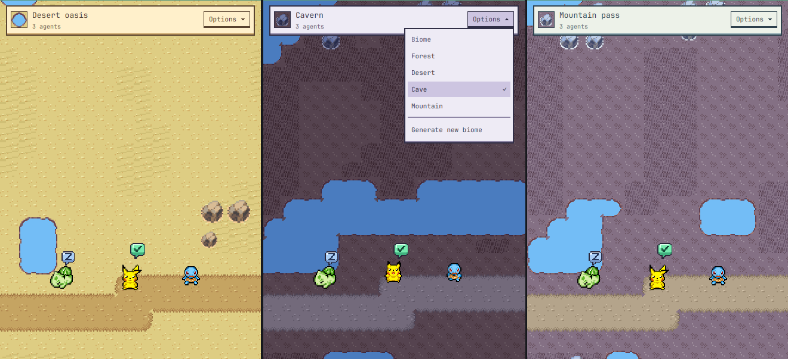

# Pokémon Agents

Turn a Herdr panel into a Pokémon habitat where companions roam, show agent status, and evolve as their agents accumulate working time.

[](docs/screenshots/forest-habitat.webp)

## Explore the habitat

- **Left-click** a companion to open its agent.
- **Right-click and drag** a companion to move it.
- **Hover** over a companion to see its agent’s status and accumulated working time in a Pokédex card.

Choose **Options → Biome** to switch between Forest, Desert, Cave, and Mountain. Each habitat saves its biome and seed. Resizing reveals more of the same landscape. Choose **Options → Generate new biome** for a new landscape in the current biome.

[](docs/screenshots/biome-gallery.webp)

## Install

With Herdr running and a space selected, paste this into a local Linux or macOS terminal. The installer uses Git and opens the habitat in a new tab. Tested with Herdr 0.1.16. [Herdr installation](https://github.com/herdrdev/herdr-app)

```sh
curl -fsSL https://raw.githubusercontent.com/DavDave1/herdr-pokeon-agents/main/install.sh | sh
```

With Node.js 22 or newer and npm available, the installer sets up downloadable terrain, sprites, and effects. Herdr needs `node` on its PATH to use them. The habitat uses placeholder artwork while downloads load or when the helper is unavailable.

### Manual install

Place the extracted release folder at `~/.config/herdr-app/mods/pokemon-agents/`, with `mod.json` and `main.js` at its root. Use your configured Herdr home if it differs. For downloaded artwork, run `npm ci` in the mod folder. Open the habitat with `herdr-app do tab.new '{"name":"Pokémon","mod":"pokemon-agents"}'`.

### Use as the Agents panel

Open a personal layout or duplicate the shipped one.

```sh
herdr-app do layout.clone '{"name":"main","as":"pokemon-agents"}'
```

In the personal layout's JSON file under Herdr's `layouts/` directory, find the block with `"id": "agents"` and set its `content` to `{"mod":"pokemon-agents"}`. Herdr applies the edit live.

## Development

Run these commands from the mod folder.

```sh
npm ci
npm test
herdr-app check .
```

Herdr loads the panel as JavaScript from `main.js`. The panel calls a separate Node.js process to download and prepare artwork. The tests run offline.

## License and artwork

The MIT license covers this project's code and original placeholder artwork. Optional artwork is fetched from SpriteCollab and pret's Pokémon Emerald archive. For source credits, cache locations, and artwork terms, see [ASSETS.md](ASSETS.md). [MIT license](LICENSE)

The screenshots show sample agents with Chunsoft Pokémon sprites sourced through SpriteCollab and terrain from Pokémon Emerald by Nintendo, Game Freak, and The Pokémon Company. The illustrated artwork belongs to its respective rights holders.
